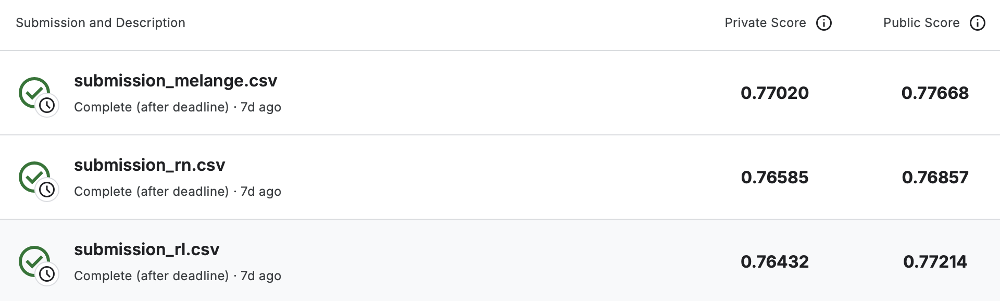

# Home Credit Default Risk: Credit Scoring

> 🇫🇷 **Résumé :** prédiction du risque de défaut de crédit sur le challenge Kaggle Home Credit (307 511 demandes de prêt). Agrégation par client de 6 tables d'historique bancaire (bureau de crédit, demandes précédentes, échéances, cartes de crédit…), création de ratios financiers, puis régression logistique, perceptron multicouche et ensemble pondéré des deux. **Score Kaggle privé : 0,770 (AUC)**. Projet de groupe, Master 2 TIDE, Université Paris 1 Panthéon-Sorbonne.

Predicting whether a loan applicant will have repayment difficulties, on the [Kaggle Home Credit Default Risk](https://www.kaggle.com/competitions/home-credit-default-risk) competition.

| | |
|---|---|
| **Data** | 307,511 loan applications + 6 relational history tables (several million rows) |
| **Features** | 365 variables after aggregation, 282 kept after removing those with more than 70 % missing values |
| **Models** | Logistic regression, multilayer perceptron, weighted ensemble |
| **Result** | **Kaggle private AUC 0.770** (weighted ensemble), validation AUC 0.777 |
| **Stack** | Python, pandas, NumPy, scikit-learn |

## Approach

1. **Financial ratios** on the application: credit / income, annuity / income, credit term, goods price / credit.
2. **Adjusted demographic variables**: employment length relative to age, income per household member, share of children, age and seniority in years.
3. **External scores**: mean, min, max, standard deviation and product of the three `EXT_SOURCE` scores, the most predictive variables of the dataset.
4. **Aggregation of 6 relational tables per client**, each summarised into behavioural indicators:
   - `bureau` and `bureau_balance`: credits held at other institutions, debt-to-credit ratio, overdue amounts, closed credits;
   - `previous_application`: past applications, **approval and refusal rates**;
   - `POS_CASH_balance`: monthly history of current loans, days past due ratio;
   - `installments_payments`: **late payment and underpayment rates**, gap between amount due and paid;
   - `credit_card_balance`: card utilisation rate, drawings relative to the limit, payment delays.
5. **Preprocessing**: columns with more than 70 % missing values dropped, label encoding fitted on train and test together, **median imputation and standardisation fitted on the training set only** (no leakage), stratified 80 / 20 split.
6. **Modelling**: L2 logistic regression (regularisation tuned on validation AUC), MLP with early stopping (4 architectures compared), then a **weighted average of both probabilities**, the weight being tuned on validation AUC.

## Results

| Model | Validation AUC | Kaggle public AUC | Kaggle private AUC |
|---|---|---|---|
| Logistic regression (C = 10) | 0.774 | 0.772 | 0.764 |
| MLP (150, 100, 50) | 0.768 | 0.769 | 0.766 |
| **Weighted ensemble (0.65 LR + 0.35 MLP)** | **0.777** | **0.777** | **0.770** |

Combining two complementary models beats each one taken alone: the ensemble ranks a defaulting client above a non-defaulting one about 77 % of the time.



## Repository structure

```
├── notebooks/
│   └── home_credit_default_risk.ipynb   # full pipeline with outputs (comments in French)
├── images/
├── requirements.txt
└── README.md
```

## How to run

The notebook is designed to run **on Kaggle**: create a notebook from the competition page (the data is attached automatically), import `home_credit_default_risk.ipynb` and run all cells. The data is subject to the Kaggle competition rules and is not included here.

## Context

Group project, Non-Linear Econometric Models course, Master 2 TIDE (*Traitement de l'Information et Data Science en Entreprise*), Université Paris 1 Panthéon-Sorbonne, 2025-2026.
